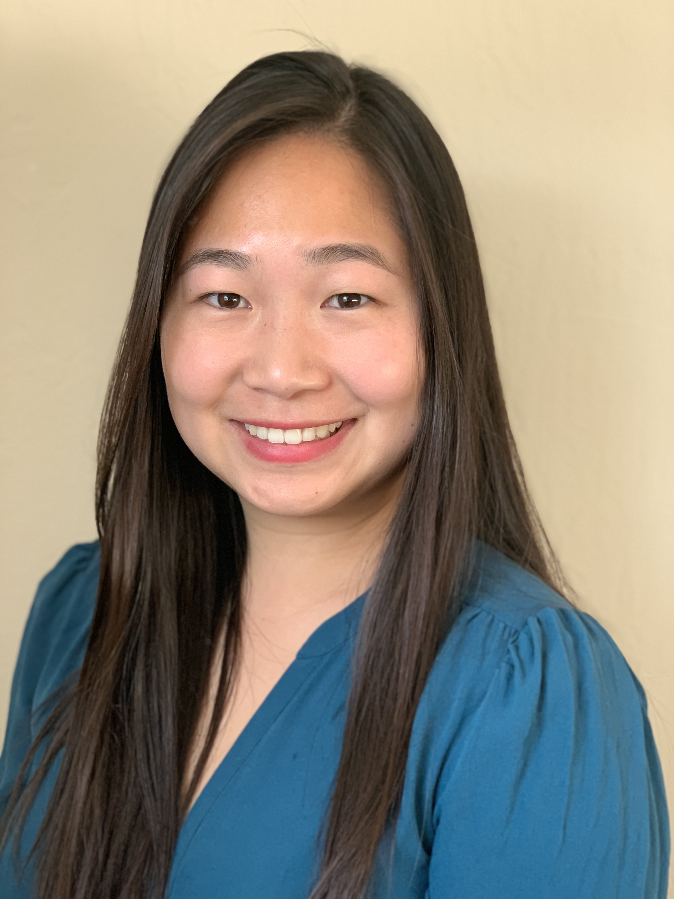

	
	
# Serena L. Wang 

I am an Assistant Professor in Computer Science at the [University of British Columbia](https://www.cs.ubc.ca/), and a Canada CIFAR AI Chair affiliated with [Amii](https://www.amii.ca/).

I have also concurrently worked with [Google Research](https://research.google/people/SerenaLutongWang/) at 20% time since 2016, where I have had the privilege of working with [Ravi Kumar](https://sites.google.com/site/ravik53/), [Preston McAfee](https://mc4f.ee/), and [Maya Gupta](https://mayagupta.org/). 

I was a Postdoctoral Fellow at [Harvard](https://crcs.seas.harvard.edu/people/serena-wang) hosted by [Ariel Procaccia](https://procaccia.info/) from 2024-2026. I completed my PhD in Electrical Engineering and Computer Science at the [University of California, Berkeley](https://eecs.berkeley.edu/), advised by [Michael I. Jordan](https://people.eecs.berkeley.edu/~jordan/). 

My research is motivated by the goal of understanding and improving the long term societal impacts of AI. AI is not developed in a vacuum, but is part of a multi-stakeholder ecosystem with asymmetries in information, power, and values, and I think about incentives and decision making in this ecosystem. My recent work focuses on the role of evaluation in the AI ecosystem, including how to mitigate gaming [[WBAJ'25]](https://proceedings.mlr.press/v238/wang24b/wang24b.pdf), how to discover new metrics [[WJLM'25]](https://dl.acm.org/doi/10.1145/3696410.3714864) [[WBKLMV'25]](https://arxiv.org/abs/2509.16655), and how to think about representation and fairness [[PSWZ'25]](https://arxiv.org/abs/2506.09813). My research combines ideas from AI/ML, economics, statistics, and optimization.

<!--My research focuses on understanding and improving the long term societal impacts of AI by rethinking algorithms and their surrounding incentives and practices. -->
<!-- gaps between metrics and goals, and how those gaps may be bridged through algorithmic improvements, analysis of multi-agent incentives and interdependence, and better understanding of intervention context.  -->
<!-- My PhD research was supported by the Apple Scholars in AI/ML PhD Fellowship and the NSF Graduate Research Fellowship. -->

<b>I am recruiting PhD and PhD-track Masters students applying in Fall 2026 to start in 2027. </b>
If you're interested in working with me, please apply through [UBC Computer Science](https://www.cs.ubc.ca/students/grad/admissions) and list my name in your application. I will not be able to respond to individual email inquiries about admissions.

Email: `serenalw (at) cs.ubc.ca`

